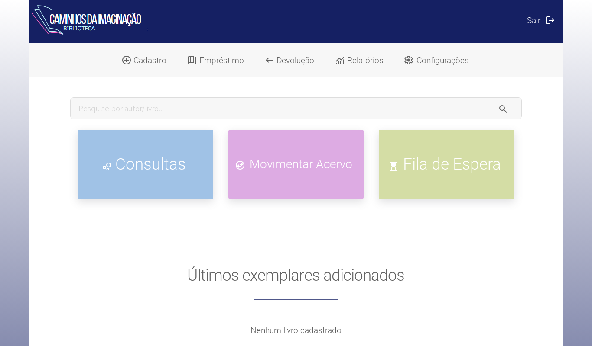
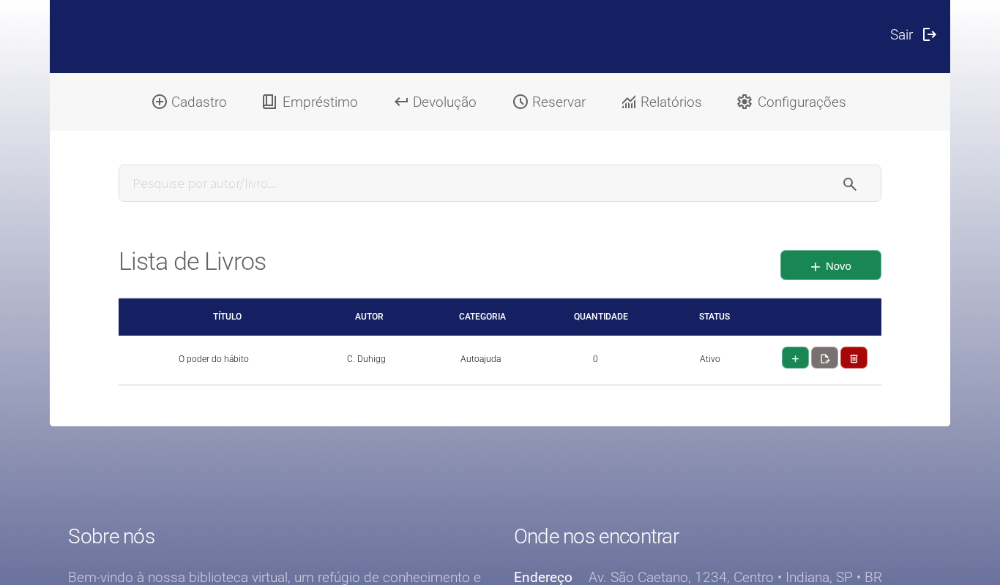

# 📚 Sistema Biblioteca

Sistema web para **gerenciamento de biblioteca**: cadastro de livros, autores e categorias por uma **API REST em Node.js + Express + MySQL**, com telas em HTML, CSS e JavaScript que consomem a API, e um módulo em **PHP (MVC)** para login de funcionários, cadastro de usuários e reservas.


## 📸 Screenshots

> Capturadas rodando localmente. A tela de livros está ligada à API e ao MySQL criado com `database/schema.sql`, com um livro de teste cadastrado pela própria API. A tela inicial é estática.

| Tela inicial | Livros |
|---|---|
|  |  |

## ✨ Funcionalidades

**API REST (Node.js)**
- CRUD de **livros** (título, ISBN, status ativo/inativo, sinopse, imagem, autor e categoria).
- CRUD de **autores** e de **categorias**.
- Listagem de livros com o nome do autor e da categoria (JOIN no MySQL).

**Front-end (HTML/CSS/JS)**
- Tela inicial com menu de cadastros, empréstimo, devolução, relatórios e configurações.
- Tela de livros com tabela, sinopse em modal e formulário para cadastrar e editar livros pela API.
- Página "Sobre nós".

**Módulo PHP (MVC)**
- Login de funcionário com sessão e logout.
- Cadastro, edição, exclusão e busca de usuários.
- Cadastro de reservas de livros para leitores.

## 🔌 Endpoints da API

Base: `http://localhost:3000`

| Método | Rota | Descrição |
|---|---|---|
| GET | `/` | Teste ("Sistema bibliotecário") |
| GET | `/livros` | Lista livros |
| GET | `/livros/:id` | Busca livro |
| POST | `/livros` | Cadastra livro |
| PUT | `/livros/:id` | Atualiza livro |
| DELETE | `/livros/:id` | Remove livro |
| GET · POST | `/autores` | Lista / cadastra autores |
| GET · PUT · DELETE | `/autores/:id` | Busca / atualiza / remove autor |
| GET · POST | `/categorias` | Lista / cadastra categorias |
| GET · PUT · DELETE | `/categorias/:id` | Busca / atualiza / remove categoria |

## 📁 Estrutura do projeto

```
library-management-node-php/
├── assets/                 # CSS, imagens e scripts do front-end
├── database/schema.sql     # Script do banco bibliotec
├── package.json
└── src/
    ├── server.js           # Servidor Express (porta 3000)
    ├── db/                 # Conexão MySQL (mysql2) e interface base dos models
    ├── routes/             # Rotas de livros, autores, categorias e exemplares
    ├── controllers/        # Controllers JS (API) e PHP (login, usuários, reservas)
    ├── models/             # Models JS (API) e PHP
    ├── services/           # Empréstimo e devolução
    ├── views/              # Scripts das telas (JS) e views PHP
    ├── index.html          # Tela inicial
    ├── livro.html          # Tela de livros
    └── sobre-nos.html
```

## ▶️ Como executar (API + front-end)

Pré-requisitos: **Node.js** e **MySQL**.

1. Clone o projeto e crie o banco `bibliotec` com o script incluído:
   ```bash
   git clone https://github.com/lukinha21/library-management-node-php.git
   cd library-management-node-php
   mysql -u root -p < database/schema.sql
   ```
2. Ajuste host, usuário e senha em `src/db/connection.js` (padrão: `root` / `123456`).
3. Instale e rode a API:
   ```bash
   npm install
   npm run dev
   ```
   A API sobe em **http://localhost:3000**.
4. Abra `src/index.html` com o **Live Server** do VS Code (porta 5500). A API libera CORS para `http://127.0.0.1:5500`.

### Módulo PHP

Precisa de **PHP 8 com a extensão mysqli** e do mesmo banco `bibliotec` (configuração em `src/models/Database.php`). Pode ser o XAMPP ou o servidor embutido do PHP:

```bash
php -S localhost:8000 -t src
```

1. Cadastre um usuário para entrar (`nivel_priv` 0 abre a tela de funcionário; 1, a tela inicial com acesso a usuários e reservas):
   ```sql
   INSERT INTO bibliotec.usuario (login, senha, nivel_priv, ativo) VALUES ('admin', 'admin', 1, 1);
   ```
2. Acesse **http://localhost:8000/views/loginView.php**.

Para cadastrar reservas, o leitor precisa existir nas tabelas `pessoa` e `leitor`.

## 🚧 Status

Projeto em desenvolvimento: as rotas de exemplares e os serviços de empréstimo e devolução já existem no código, mas ainda não estão ligados à API.

## 👨‍💻 Autores

**Lucas Alexandre**, estudante de Sistemas de Informação na Unoeste

- GitHub: [@lukinha21](https://github.com/lukinha21)
- LinkedIn: [Lucas Silva](https://www.linkedin.com/in/lucas-silva-025583180)

Projeto desenvolvido com **Beatriz Araújo**.
